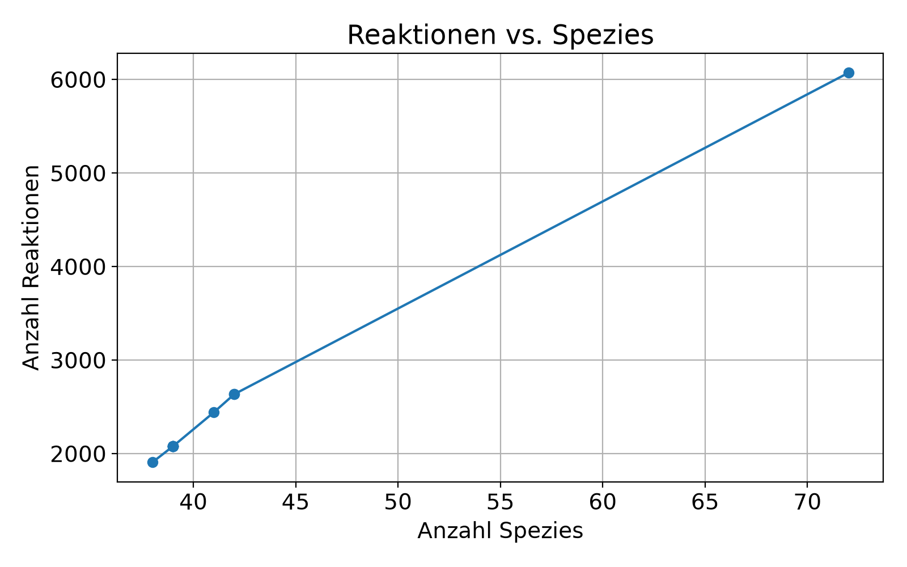
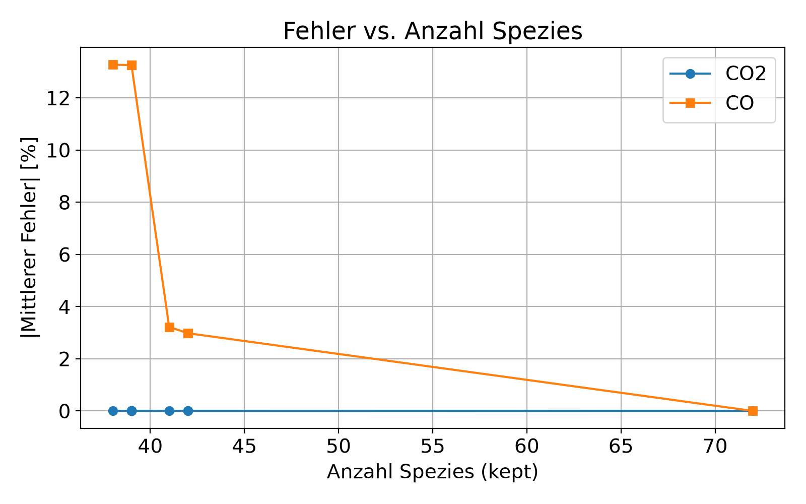
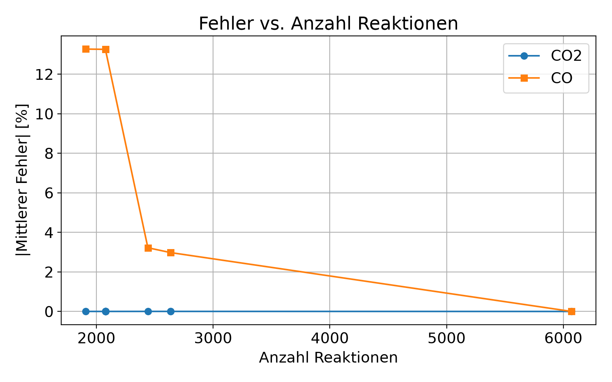
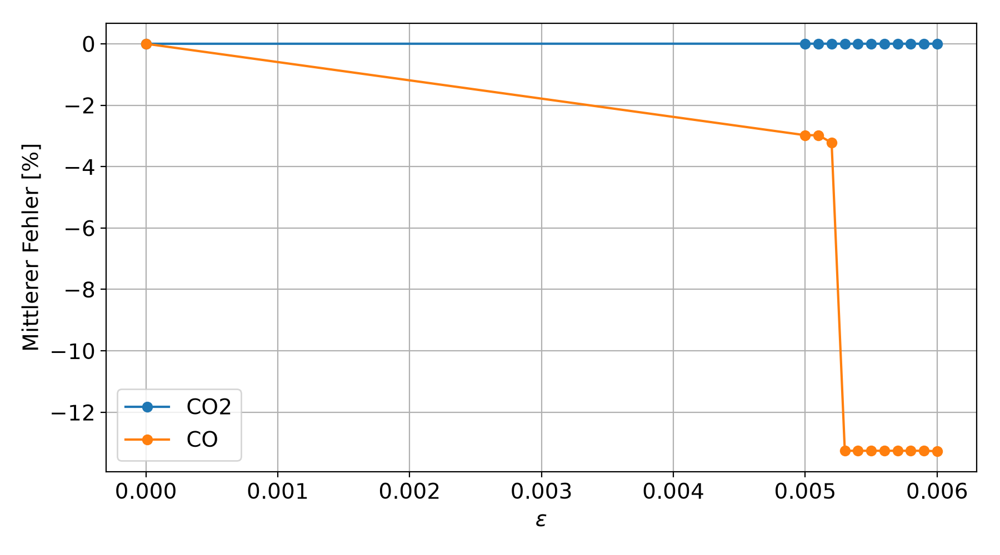
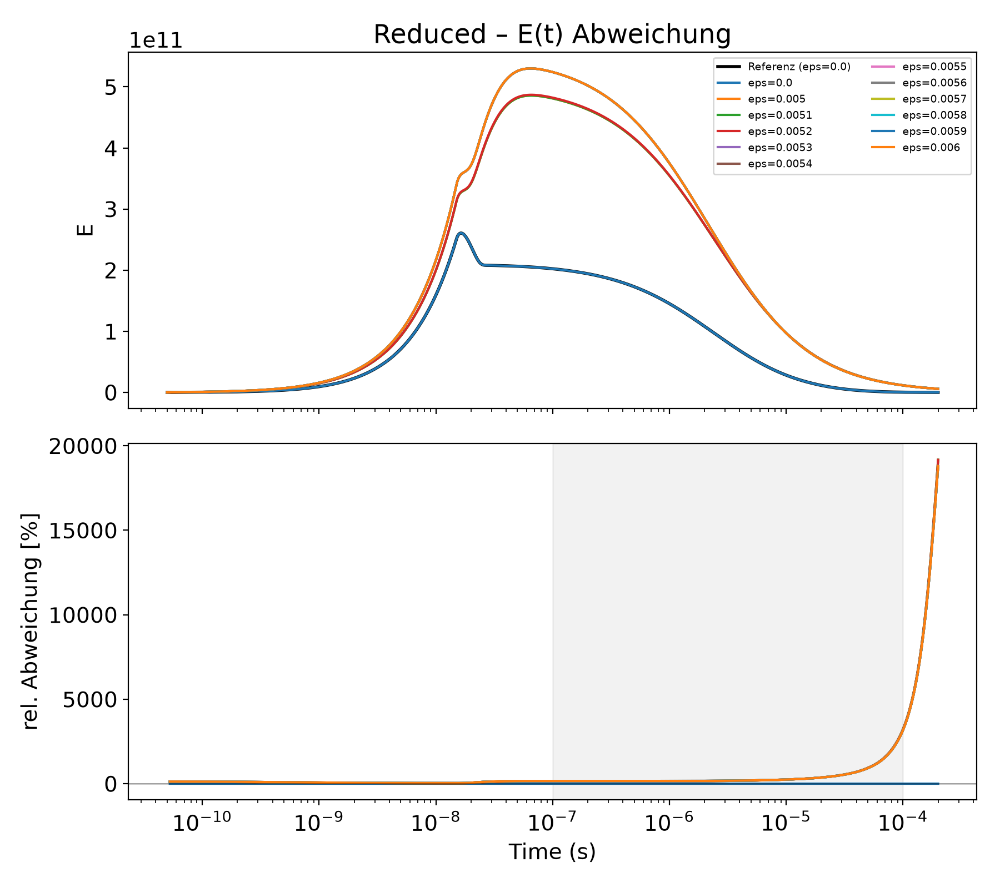
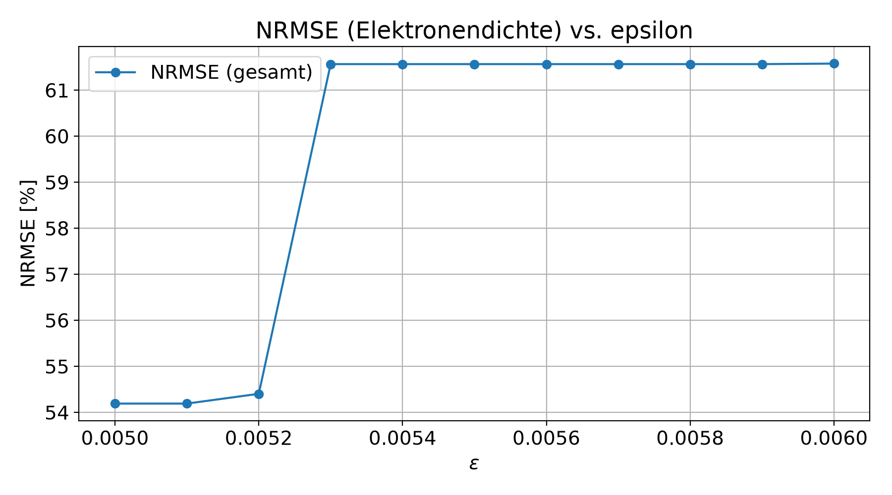

# Run-Report: Reduced_20261005_1219

*Erstellt am 2026-10-07 09:47*

## Inhalt
1. [Allgemeine Informationen](#1-allgemeine-informationen)
2. [Parameterwerte je Run](#2-parameterwerte-je-run)
3. [Mechanismus-Reduktion (DRGEP)](#3-mechanismus-reduktion-drgep)
4. [Fehleranalyse ggü. Referenz](#4-fehleranalyse-ggü-referenz)
5. [Empfehlung](#5-empfehlung)
6. [Hinweise / Annahmen](#6-hinweise--annahmen)

## 1. Allgemeine Informationen

- **Run-Name:** Reduced_20261005_1219
- **Speicherpfad:** `C:\Users\NiklasMeier\Desktop\Finaler Code\1_create_data_and_preparation\Runs\Reduced_20261005_1219`
- **Study-Datum / Uhrzeit:** 20261005 / 1219
- **Variierter Parameter:** Reduced
- **Anzahl Runs:** 12
- **Referenz-/Baseline-Run:** Run 1 (param_value=0.000e+00)
- **Grund für den Run:** sdf

## 2. Parameterwerte je Run

| Run | param_value | epsilon (dic_reduced) | delta (dic_reduced) | POWPLUG_peak [W/cm3] | XPOW | CO2-Konversion [%] | CO-Produktion [%] |
| --- | --- | --- | --- | --- | --- | --- | --- |
| 1 | 0.000e+00 | 0 | 0 | 2e+05 | 0.0, 1.5e-08, 3e-08, 0.002 | 0.02426 | 0.0001746 |
| 2 | 5.000e-03 | 0.005 | 0 | 2e+05 | 0.0, 1.5e-08, 3e-08, 0.002 | 0.02848 | 0.0001788 |
| 3 | 5.100e-03 | 0.0051 | 0 | 2e+05 | 0.0, 1.5e-08, 3e-08, 0.002 | 0.02848 | 0.0001788 |
| 4 | 5.200e-03 | 0.0052 | 0 | 2e+05 | 0.0, 1.5e-08, 3e-08, 0.002 | 0.02853 | 0.0001792 |
| 5 | 5.300e-03 | 0.0053 | 0 | 2e+05 | 0.0, 1.5e-08, 3e-08, 0.002 | 0.02663 | 0.0001967 |
| 6 | 5.400e-03 | 0.0054 | 0 | 2e+05 | 0.0, 1.5e-08, 3e-08, 0.002 | 0.02663 | 0.0001967 |
| 7 | 5.500e-03 | 0.0055 | 0 | 2e+05 | 0.0, 1.5e-08, 3e-08, 0.002 | 0.02663 | 0.0001967 |
| 8 | 5.600e-03 | 0.0056 | 0 | 2e+05 | 0.0, 1.5e-08, 3e-08, 0.002 | 0.02663 | 0.0001967 |
| 9 | 5.700e-03 | 0.0057 | 0 | 2e+05 | 0.0, 1.5e-08, 3e-08, 0.002 | 0.02663 | 0.0001967 |
| 10 | 5.800e-03 | 0.0058 | 0 | 2e+05 | 0.0, 1.5e-08, 3e-08, 0.002 | 0.02663 | 0.0001967 |
| 11 | 5.900e-03 | 0.0059 | 0 | 2e+05 | 0.0, 1.5e-08, 3e-08, 0.002 | 0.02663 | 0.0001967 |
| 12 | 6.000e-03 | 0.006 | 0 | 2e+05 | 0.0, 1.5e-08, 3e-08, 0.002 | 0.02664 | 0.0001967 |

_(sortiert nach param_value; `Run` = originaler Model-Laufindex. Vollständige Tabelle inkl. Fehlerwerten: siehe `Report/run_table.csv`)_

## 3. Mechanismus-Reduktion (DRGEP)

- **POWPLUG der Daten, die zur Reduktion führten:** 2e+05
- **Target-Spezies:** CO2, CO

### Übersicht epsilon / delta / Spezies- & Reaktionsanzahl

| POWPLUG (Reduktion) | epsilon | delta (sigma) | num_species | kept_reactions | num_eliminated_species |
| --- | --- | --- | --- | --- | --- |
| 2e+05 | 0 | 0 | 72 | 6071 | 1 |
| 2e+05 | 0.005 | 0 | 42 | 2635 | 30 |
| 2e+05 | 0.0051 | 0 | 42 | 2635 | 30 |
| 2e+05 | 0.0052 | 0 | 41 | 2441 | 31 |
| 2e+05 | 0.0053 | 0 | 39 | 2077 | 33 |
| 2e+05 | 0.0054 | 0 | 39 | 2077 | 33 |
| 2e+05 | 0.0055 | 0 | 39 | 2077 | 33 |
| 2e+05 | 0.0056 | 0 | 39 | 2077 | 33 |
| 2e+05 | 0.0057 | 0 | 39 | 2077 | 33 |
| 2e+05 | 0.0058 | 0 | 39 | 2077 | 33 |
| 2e+05 | 0.0059 | 0 | 39 | 2077 | 33 |
| 2e+05 | 0.006 | 0 | 38 | 1907 | 34 |

### Eliminierte Spezies je Epsilon-Stufe

_Zur Kontrolle, ob bei einer bestimmten epsilon-Stufe eine wichtige Spezies (z.B. ein Target) unerwartet wegfällt._

| POWPLUG | epsilon | delta (sigma) | Anzahl eliminiert | Eliminierte Spezies |
| --- | --- | --- | --- | --- |
| 2e+05 | 0.005 | 0 | 30 | C, C2, C2O, C2^, CO2e2, CO2v08, CO2v11, CO2v14, CO2v20, CO2v21, CO3-, CO4-, CO4^, COe1, COe2, COv02, COv03, COv10, C^, O2-, O2^, O2e1, O2e2, O2v02, O2v03, O3, O3-, O4-, O4^, O^ |
| 2e+05 | 0.0051 | 0 | 30 | C, C2, C2O, C2^, CO2e2, CO2v08, CO2v11, CO2v14, CO2v20, CO2v21, CO3-, CO4-, CO4^, COe1, COe2, COv02, COv03, COv10, C^, O2-, O2^, O2e1, O2e2, O2v02, O2v03, O3, O3-, O4-, O4^, O^ |
| 2e+05 | 0.0052 | 0 | 31 | C, C2, C2O, C2^, CO2e2, CO2v08, CO2v11, CO2v13, CO2v14, CO2v20, CO2v21, CO3-, CO4-, CO4^, COe1, COe2, COv02, COv03, COv10, C^, O2-, O2^, O2e1, O2e2, O2v02, O2v03, O3, O3-, O4-, O4^, O^ |
| 2e+05 | 0.0053 | 0 | 33 | C, C2, C2O, C2^, CO2e2, CO2v05, CO2v08, CO2v11, CO2v12, CO2v13, CO2v14, CO2v20, CO2v21, CO3-, CO4-, CO4^, COe1, COe2, COv02, COv03, COv10, C^, O2-, O2^, O2e1, O2e2, O2v02, O2v03, O3, O3-, O4-, O4^, O^ |
| 2e+05 | 0.0054 | 0 | 33 | C, C2, C2O, C2^, CO2e2, CO2v05, CO2v08, CO2v11, CO2v12, CO2v13, CO2v14, CO2v20, CO2v21, CO3-, CO4-, CO4^, COe1, COe2, COv02, COv03, COv10, C^, O2-, O2^, O2e1, O2e2, O2v02, O2v03, O3, O3-, O4-, O4^, O^ |
| 2e+05 | 0.0055 | 0 | 33 | C, C2, C2O, C2^, CO2e2, CO2v05, CO2v08, CO2v11, CO2v12, CO2v13, CO2v14, CO2v20, CO2v21, CO3-, CO4-, CO4^, COe1, COe2, COv02, COv03, COv10, C^, O2-, O2^, O2e1, O2e2, O2v02, O2v03, O3, O3-, O4-, O4^, O^ |
| 2e+05 | 0.0056 | 0 | 33 | C, C2, C2O, C2^, CO2e2, CO2v05, CO2v08, CO2v11, CO2v12, CO2v13, CO2v14, CO2v20, CO2v21, CO3-, CO4-, CO4^, COe1, COe2, COv02, COv03, COv10, C^, O2-, O2^, O2e1, O2e2, O2v02, O2v03, O3, O3-, O4-, O4^, O^ |
| 2e+05 | 0.0057 | 0 | 33 | C, C2, C2O, C2^, CO2e2, CO2v05, CO2v08, CO2v11, CO2v12, CO2v13, CO2v14, CO2v20, CO2v21, CO3-, CO4-, CO4^, COe1, COe2, COv02, COv03, COv10, C^, O2-, O2^, O2e1, O2e2, O2v02, O2v03, O3, O3-, O4-, O4^, O^ |
| 2e+05 | 0.0058 | 0 | 33 | C, C2, C2O, C2^, CO2e2, CO2v05, CO2v08, CO2v11, CO2v12, CO2v13, CO2v14, CO2v20, CO2v21, CO3-, CO4-, CO4^, COe1, COe2, COv02, COv03, COv10, C^, O2-, O2^, O2e1, O2e2, O2v02, O2v03, O3, O3-, O4-, O4^, O^ |
| 2e+05 | 0.0059 | 0 | 33 | C, C2, C2O, C2^, CO2e2, CO2v05, CO2v08, CO2v11, CO2v12, CO2v13, CO2v14, CO2v20, CO2v21, CO3-, CO4-, CO4^, COe1, COe2, COv02, COv03, COv10, C^, O2-, O2^, O2e1, O2e2, O2v02, O2v03, O3, O3-, O4-, O4^, O^ |
| 2e+05 | 0.006 | 0 | 34 | C, C2, C2O, C2^, CO2e2, CO2v05, CO2v08, CO2v11, CO2v12, CO2v13, CO2v14, CO2v19, CO2v20, CO2v21, CO3-, CO4-, CO4^, COe1, COe2, COv02, COv03, COv10, C^, O2-, O2^, O2e1, O2e2, O2v02, O2v03, O3, O3-, O4-, O4^, O^ |

## 4. Fehleranalyse ggü. Referenz

### CO2 / CO Fehler & NRMSE der Elektronendichte

| Run | param_value | CO2-Fehler [%] | CO-Fehler [%] | NRMSE_E_gesamt_% | NRMSE_E_fenster_% |
| --- | --- | --- | --- | --- | --- |
| 1 | 0.000e+00 | 0 | 0 | 0 | 0 |
| 2 | 5.000e-03 | 0.002676 | -2.977 | 54.19 | 65.07 |
| 3 | 5.100e-03 | 0.002676 | -2.977 | 54.19 | 65.07 |
| 4 | 5.200e-03 | 0.002711 | -3.221 | 54.4 | 65.29 |
| 5 | 5.300e-03 | 0.001332 | -13.25 | 61.57 | 72.66 |
| 6 | 5.400e-03 | 0.001332 | -13.25 | 61.57 | 72.66 |
| 7 | 5.500e-03 | 0.001332 | -13.25 | 61.57 | 72.66 |
| 8 | 5.600e-03 | 0.001332 | -13.25 | 61.57 | 72.66 |
| 9 | 5.700e-03 | 0.001332 | -13.25 | 61.57 | 72.66 |
| 10 | 5.800e-03 | 0.001332 | -13.25 | 61.57 | 72.66 |
| 11 | 5.900e-03 | 0.001332 | -13.25 | 61.57 | 72.66 |
| 12 | 6.000e-03 | 0.001333 | -13.27 | 61.58 | 72.67 |

_(sortiert nach param_value; `Run` = originaler Model-Laufindex.)_

**Hinweis:** Folgende Runs liefern (auf 4 Nachkommastellen) identische Fehlerwerte — meist ein Zeichen, dass DRGEP für die betroffenen epsilon/delta-Werte dieselbe Spezies-/Reaktionsmenge behalten hat, der reduzierte Mechanismus also identisch ist:
- Runs 5, 6, 7, 8, 9, 10, 11: identische Fehlerwerte (CO2-Fehler [%]=0.0013, CO-Fehler [%]=-13.25, NRMSE_E_gesamt_%=61.57)
- Runs 2, 3: identische Fehlerwerte (CO2-Fehler [%]=0.0027, CO-Fehler [%]=-2.977, NRMSE_E_gesamt_%=54.19)

## 5. Empfehlung

_Kein Run erfüllt die Kriterien (CO2-Fehler ≤ 2.0% und NRMSE(E) ≤ 5.0%). Ggf. Schwellwerte über --co2-threshold / --nrmse-threshold anpassen._

## 6. Hinweise / Annahmen

- Baseline-Run wird automatisch als der Run mit param_value ≈ 0 identifiziert.
- Die Zuordnung von dic_reduced-Einträgen zu Run-Indizes erfolgt über die Reihenfolge im dic_reduced-dict (wie in `compare_pkl.py`). Zur Kontrolle stehen in der Tabelle sowohl die direkt aus dem Study-Objekt gelesenen Parameterwerte (`epsilon`, `delta`) als auch die aus dic_reduced abgeleiteten (`epsilon (dic_reduced)`, `delta (dic_reduced)`) — bei Abweichung bitte die Zuordnungslogik in `map_dic_reduced_to_runs()` prüfen.
- Felder pro (epsilon, delta)-Eintrag werden aus `kept_species`, `eliminated_species`, `kept_reactions`, `powplug`, `epsilon` gelesen (wie in `create_data_reduced_dic()` erzeugt). Zusätzliche, unbekannte Felder werden automatisch mit in die Tabelle übernommen.
- Schwellwerte für die Empfehlung: CO2-Fehler ≤ 2.0%, NRMSE(E) ≤ 5.0% (änderbar über --co2-threshold / --nrmse-threshold).
